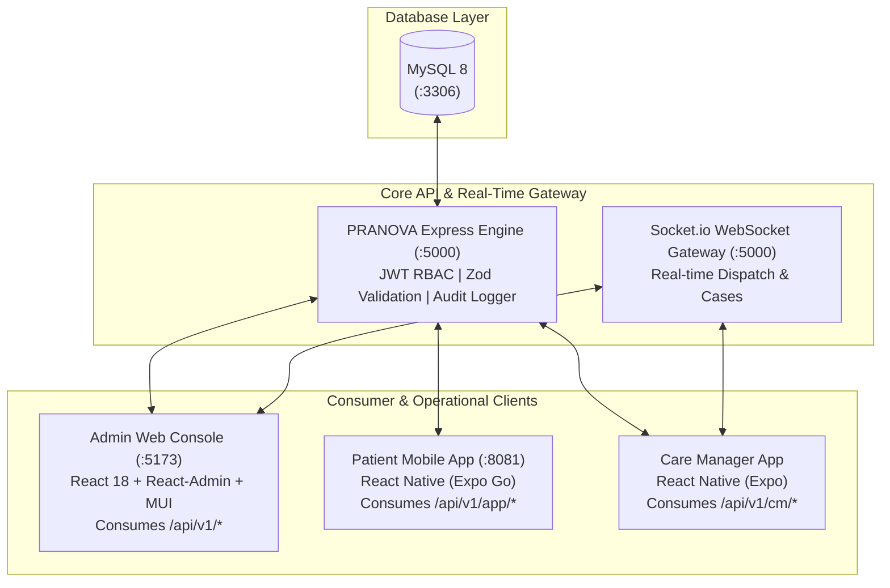

# PRANOVA Healthcare Platform — Complete Architecture Testing & Verification Guide

> **Local Network IP:** `192.168.1.46`  
> **Metro Bundler (Patient App):** `exp://192.168.1.46:8081`  
> **Backend API Base:** `http://192.168.1.46:5000/api/v1`  
> **Admin Web Console:** `http://192.168.1.46:5173`  
> **Swagger API Docs:** `http://192.168.1.46:5000/api-docs`

---

## 1. Architecture Topology

PRANOVA operates as a strictly headless, API-first healthcare coordination platform where one centralized Express/Prisma backend engine powers three distinct client surfaces:



---

## 2. Platform Component Status Matrix

| Component | Port | Network URL | Status | Tech Stack |
| :--- | :--- | :--- | :--- | :--- |
| **Database** | `3306` | `127.0.0.1:3306` | **ACTIVE** | MySQL 8 / MariaDB / Prisma ORM |
| **Backend API** | `5000` | `http://192.168.1.46:5000/api/v1` | **ACTIVE** | Node.js, Express, TypeScript |
| **Admin Web** | `5173` | `http://192.168.1.46:5173` | **ACTIVE** | React 18, React-Admin v5, Vite |
| **Patient App** | `8081` | `exp://192.168.1.46:8081` | **ACTIVE** | React Native (Expo SDK 57), React 19, Expo Router |
| **Care Manager** | Dynamic | `care-manager-app/` | Ready to start | React Native, Expo, Socket.io |

---

## 3. How to Test the Patient App in Expo Go

### Prerequisites
1. Ensure your physical mobile device (Android / iOS) is connected to the **same Wi-Fi network** as this PC (`192.168.1.x`).
2. Download and install **Expo Go** from Google Play Store or Apple App Store.

### Step 1: Open the App in Expo Go
- **On Android:**
  - Open **Expo Go**.
  - Under **"Recently in development"**, tap `PRANOVA Patient`.
  - *Alternatively*, tap **"Enter URL manually"** and type:
    ```text
    exp://192.168.1.46:8081
    ```
- **On iOS:**
  - Open the **Camera** app and scan the QR code displayed in your Metro terminal, or open **Expo Go** and tap **"Enter URL manually"** with `exp://192.168.1.46:8081`.

### Step 2: Patient Authentication
- On the Login screen:
  - **Phone Number:** `+919123456789`
  - Tap **"Send Verification Code"**
  - **OTP Code:** `123456`
  - Tap **"Verify & Sign In"**
- The app automatically stores the JWT token in `expo-secure-store` and navigates to the clinical home dashboard.

### Step 3: Feature-by-Feature Testing Checklist

#### 🩺 1. Health Dashboard (`Home` Tab)
- [ ] View personalized patient banner ("Welcome back, Ananya").
- [ ] Check Emergency 108 Dispatch callout card.
- [ ] Review horizontal Medical Specialties carousel.
- [ ] Review Top-Rated Doctors recommendations.

#### 👨‍⚕️ 2. Doctor Consultations (`Consult` Tab)
- [ ] Filter doctors by specialty (Cardiology, Dermatology, etc.) or search by doctor name.
- [ ] Tap **"Book Appointment"** on a doctor (e.g., Dr. Arvind Swaminathan).
- [ ] Select consultation mode: `Video`, `In-Clinic`, or `Audio`.
- [ ] Pick date & time slot, enter reason for visit, and submit.
- [ ] Switch to **"My Consultations"** segment: observe the newly created appointment in `CONFIRMED` or `PENDING` state.
- [ ] Test cancellation by tapping **"Cancel"** and entering a reason.

#### 📹 3. Tele-Consultation Video Room (`/video/[id]`)
- [ ] From an upcoming Video appointment card, tap **"Join Video Call"**.
- [ ] Observe clinical video room provisioning (`POST /api/v1/app/appointments/:id/video-token`).
- [ ] Verify live consultation timer, in-call audio mute toggle, camera toggle, and HIPAA security badge.
- [ ] Tap **"End Call"** to return to consultations.

#### 💊 4. Pharmacy & Medicine Orders (`Pharmacy` Tab)
- [ ] Search medicines by name (e.g., "Paracetamol", "Amoxicillin", "Atorvastatin").
- [ ] Filter by categories: `OTC`, `Prescription`, `Wellness`.
- [ ] Tap **"Add to Cart"** on multiple items. Notice the floating cart summary drawer.
- [ ] Tap **"View Cart & Checkout"**: verify pre-filled delivery address, auto delivery fee calculation (Free above ₹500), and tap **"Place Order"**.
- [ ] Switch to **"My Orders"** segment to view order status (`PLACED`, `CONFIRMED`, `DELIVERED`).

#### 🔬 5. Diagnostics & Lab Tests (`Diagnostics` Tab)
- [ ] Browse pathology test catalog (Complete Blood Count, Lipid Profile, HbA1c).
- [ ] Review fasting instructions and turnaround times.
- [ ] Tap **"Book Test"**, select `Home Sample Collection` or `Lab Visit`, select preferred slot date, and submit.
- [ ] Switch to **"My Bookings"** segment to track sample collection and report status.

#### 👤 6. Patient Profile & Records (`Profile` Tab)
- [ ] Verify clinical demographics (Blood group B+, emergency contacts, Indiranagar address).
- [ ] Check dynamic counters (Total Consultations, Orders, Lab Tests).
- [ ] Tap **"Sign Out"** to verify token cleansing from SecureStore and redirect back to login.

---

## 4. How to Test the Admin Web Console

### Step 1: Open the Admin Console
- Open your browser to: **`http://192.168.1.46:5173`** (or `http://localhost:5173`)

### Step 2: Login with System Administrator Credentials
- **Email:** `admin@example.com`
- **Password:** `admin123`
- Click **"Sign In"**

### Step 3: Admin Operational Capabilities Checklist
- **Dashboard / Metrics:** Overview of coordination cases, active patients, and clinical orders.
- **Coordination Cases (`/cases`):**
  - View acute emergency dispatch cases (e.g. `PRN-2026-1001`).
  - View immutable audit timeline events.
  - Assign Care Managers to open triage cases.
- **Patients Directory (`/patients`):** View registered patients, demographic data, medical histories.
- **Doctors & Appointments (`/doctors`, `/appointments`):**
  - Verify appointment bookings placed from the Patient Mobile App.
  - Approve, reschedule, or complete consultations.
- **Pharmacy Catalog & Orders (`/medicines`, `/orders`):**
  - View incoming patient orders.
  - Transition order lifecycle: `PLACED` → `CONFIRMED` → `PACKED` → `OUT_FOR_DELIVERY` → `DELIVERED`.
- **Diagnostics Lab Bookings (`/diagnostic-tests`, `/lab-bookings`):**
  - View home collection test requests.
  - Update status to `SAMPLE_COLLECTED` → `PROCESSING` → `REPORT_READY`.
- **Administrators & Settings (`/admins`, `/settings`):**
  - Manage admin accounts and system branding (Bagisto-style dynamic settings).
- **Audit Logs (`/audit-logs`):**
  - Verify append-only compliance audit logs capturing every mutation with IP and timestamp.

---

## 5. Cross-Surface End-to-End Integration Tests

You can test real-time cross-platform workflows simultaneously between your mobile phone and your computer browser:

### Scenario A: Telemedicine Appointment Synchronization
1. On **Patient App (Mobile)**: Book a Video Consultation with Dr. Arvind Swaminathan.
2. On **Admin Console (Web)**: Navigate to **Appointments**. The new booking immediately appears with status `CONFIRMED`.
3. On **Patient App (Mobile)**: Open the consultation card and tap **"Join Video Call"** to enter the tele-consultation room.

### Scenario B: Pharmacy Order Fulfillment Lifecycle
1. On **Patient App (Mobile)**: Add 2 strips of Paracetamol and 1 strip of Atorvastatin to cart and tap **"Place Order"**.
2. On **Admin Console (Web)**: Navigate to **Orders**. Notice the new order with status `PLACED`.
3. On **Admin Console (Web)**: Open the order and update status to `CONFIRMED` and `PACKED`.
4. On **Patient App (Mobile)**: Pull to refresh on "My Orders" tab; notice the live status update.

### Scenario C: Pathology Home Collection
1. On **Patient App (Mobile)**: Book a "Complete Blood Count (CBC)" with `Home Sample Collection`.
2. On **Admin Console (Web)**: Navigate to **Lab Bookings**. Assign field phlebotomist and update status to `SAMPLE_COLLECTED`.
3. On **Patient App (Mobile)**: View real-time tracking badge update.

---

## 6. How to Start & Test the Care Manager App

To run the second mobile client (`care-manager-app`):
1. Open a new terminal:
   ```bash
   cd d:\PRANOVA\care-manager-app
   npm install
   npx expo start --go --port 8082
   ```
2. Scan or enter `exp://192.168.1.46:8082` in Expo Go.
3. Login using Care Manager credentials:
   - **Phone:** `+919876543210`
   - **OTP:** `123456`
4. Care Manager can receive real-time dispatch alerts and update field triage status over WebSockets.

---

## 7. Network & Firewall Troubleshooting

If Expo Go on your mobile device displays a connection timeout or network error:

1. **Verify Same Wi-Fi Network:** Ensure your mobile phone and PC are connected to the same Wi-Fi SSID (`192.168.1.x`).
2. **Wi-Fi Router AP Isolation:** If your Wi-Fi router has "Client Isolation" or "AP Isolation" enabled, devices cannot see each other. In that case, start Expo using the ngrok tunnel:
   ```bash
   cd patient-app
   npx expo start --tunnel
   ```
3. **Windows Firewall Rule:**
   If Windows Defender blocks incoming connections to port 5000 or 8081, run in an administrative PowerShell:
   ```powershell
   New-NetFirewallRule -DisplayName "PRANOVA Dev Ports" -Direction Inbound -LocalPort 5000,5173,8081,8082 -Protocol TCP -Action Allow
   ```
4. **Backend Health Check from Mobile Browser:**
   Open Chrome/Safari on your mobile phone and navigate to:
   `http://192.168.1.46:5000/api/v1/health`  
   You should see: `{"success": true, "message": "PRANOVA API Engine v1 is healthy"}`.
